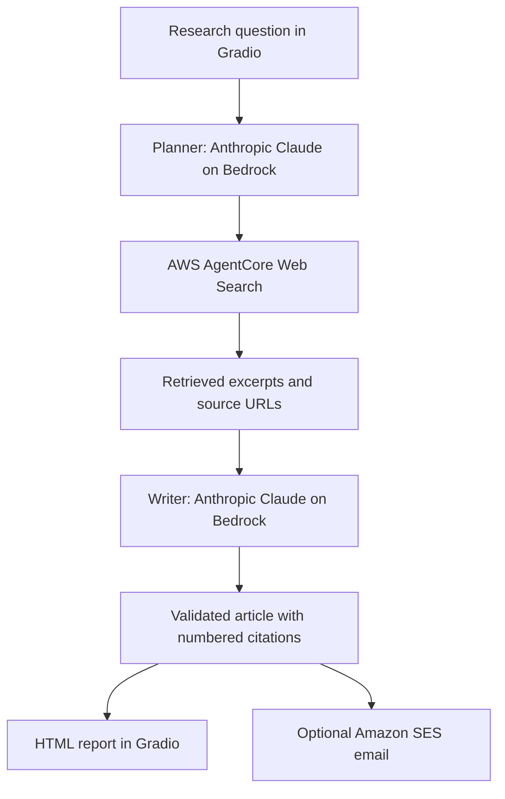

> AWS/Claude version. Run every command from `QueryQuest_AWS/`. This folder uses Boto3 and its own `.env`; the preserved OpenAI SDK / GPT version is in `../QueryQuest_GPT/`.

# QueryQuest

Ask a question, research the web, and get a sourced article. QueryQuest uses AWS for model inference, web search, and optional email delivery. Gradio and the Python workflow run locally; this change does not deploy the app to AWS.

**Powered by Dhaval Mistry | Mahantai**

## How it works



- The Planner and Writer call **Bedrock Converse** using Boto3. The default model is `us.anthropic.claude-sonnet-4-6`; role-specific overrides are supported.
- The Search component calls **AgentCore Web Search** (`InvokeWebSearch`) directly. It preserves retrieved excerpts, titles, and URLs without another model call. Python removes duplicate and unusable sources.
- Bedrock returns structured results using a forced output tool. Pydantic validates them; incomplete responses fail rather than becoming an article.
- The Writer receives only the question and retrieved evidence. Citation IDs are checked before displaying or emailing the report.
- **Amazon SES** sends HTML with a plain-text fallback only when the user requests delivery.
- There is no OpenAI SDK, OpenAI API request, or OpenAI tracing export. The Mantle endpoint and legacy GPT model settings are no longer used.

AWS documents the direct [AgentCore Web Search API](https://docs.aws.amazon.com/bedrock-agentcore/latest/devguide/web-search-api.html) and [Bedrock tool use](https://docs.aws.amazon.com/bedrock/latest/userguide/tool-use.html). A Gateway or third-party search provider is not required for this implementation.

## AWS Settings / Builder ID project accounts: use browser login

If AWS Settings lists a management account and a separate project account, use the project account for QueryQuest. An `AccountFullAccessRole` session is consistent with the new AWS experience. Organization policies may be managed by AWS; the IAM-user walkthrough is not the preferred path for this setup.

1. Install the current [AWS CLI v2 for Windows](https://docs.aws.amazon.com/cli/latest/userguide/getting-started-install.html), then reopen your terminal. Run `aws --version`; browser login requires version 2.32.0 or later.
2. Run `aws login --profile queryquest --region us-east-2`. Sign in in the browser and choose your existing project. If your AWS browser session is in Incognito, the browser opened by the CLI may need a fresh sign-in with the same identity.
3. Run `aws sts get-caller-identity --profile queryquest --region us-east-2`. Check that `Account` is your project account ID, not the management account.
4. In `QueryQuest_AWS/.env`, set `AWS_PROFILE=queryquest` and `AWS_REGION=us-east-2`. Comment out any manually configured `AWS_ACCESS_KEY_ID`, `AWS_SECRET_ACCESS_KEY`, and `AWS_SESSION_TOKEN` values so they do not override browser login. To use the same identity for model calls too, comment out `AWS_BEARER_TOKEN_BEDROCK`; keep the token saved privately.
5. Run `uv sync` from this folder. The project includes `boto3[crt]` because the AWS Common Runtime is required for Boto3's console-login credential provider.
6. Run `uv run python -m tests.check_model_access` and `uv run python -m tests.test_search` independently. These make real AWS requests. Authentication success does not prove that model availability, service permissions, plan restrictions, or cross-region inference requirements are satisfied.
7. Restart with `uv run python app.py`. When the login expires, repeat the `aws login` command. Do not copy cached temporary credentials into `.env`.

See [AWS project login](https://docs.aws.amazon.com/accounts/latest/reference/sign-in-new.html), [CLI browser sign-in](https://docs.aws.amazon.com/cli/latest/userguide/cli-configure-sign-in.html), and [Boto3 login credentials](https://docs.aws.amazon.com/boto3/latest/guide/credentials.html).

## Fix `NoCredentialsError` during web search

If planning succeeds but search fails with `Unable to locate credentials`, the Bedrock token is working for inference while AgentCore lacks IAM credentials. Signing into the AWS console in a browser does not configure Boto3 on your computer.

For AWS Settings / Builder ID projects, use browser login above. For traditional AWS accounts, choose one credential method:

**Existing IAM user or temporary role credentials:** obtain programmatic credentials from your AWS administrator or AWS access portal and add them privately to `QueryQuest_AWS/.env`:

```dotenv
AWS_ACCESS_KEY_ID=your_access_key_id
AWS_SECRET_ACCESS_KEY=your_secret_access_key
# Set this only when using temporary credentials:
# AWS_SESSION_TOKEN=your_session_token
```

Use the three matching values together for temporary credentials. Do not set `AWS_PROFILE` unless that profile is configured. The existing `AWS_BEARER_TOKEN_BEDROCK` can stay for inference.

**IAM Identity Center / SSO:** if your account uses SSO, install [AWS CLI v2](https://docs.aws.amazon.com/cli/latest/userguide/getting-started-install.html), then run:

```powershell
aws configure sso --profile queryquest
aws sso login --profile queryquest
aws sts get-caller-identity --profile queryquest
```

Set `AWS_PROFILE=queryquest` in this folder's `.env`. See [AWS SSO prerequisites](https://docs.aws.amazon.com/cli/latest/userguide/cli-configure-sso.html); console sign-in alone is not sufficient.

The identity needs `bedrock-agentcore:InvokeWebSearch` on `arn:aws:bedrock-agentcore:us-east-2:aws:tool/web-search.v1`. The complete starter policy below also covers Bedrock and optional SES. If credentials are now found but the request returns `AccessDeniedException`, check that permission separately.

Restart the app after editing `.env`, and test search independently:

```powershell
cd C:\code\QueryQuest\QueryQuest_AWS
uv run python -m tests.test_search
```

This manual check makes an AWS search request. Never paste credential values into chat or commit `.env`. The application now checks IAM credential availability before invoking the Planner and displays the setup error directly in Gradio; it does not create credentials or grant permissions.

## AWS setup

For Claude Sonnet 4.6, confirm your account has Anthropic model access and complete the provider's first-time use requirements where applicable. The selected `us.anthropic.claude-sonnet-4-6` inference profile is documented in the [AWS Claude model card](https://docs.aws.amazon.com/bedrock/latest/userguide/model-card-anthropic-claude-sonnet-4-6.html). See [model access requirements](https://docs.aws.amazon.com/bedrock/latest/userguide/model-access.html).


1. Configure AWS credentials with an AWS profile (for example, `aws configure sso` then `aws sso login --profile queryquest`), standard AWS environment credentials, or an IAM role when hosted on AWS. Set `AWS_PROFILE` if using a named local profile.
2. Choose a Bedrock region and a Converse-compatible model or inference profile that supports forced tool choice. The example uses Anthropic Claude in `us-east-2`. Confirm model access in your account. The `us.` inference profile may route inference across US regions; use a suitable regional model ID if your residency requirements call for it.
3. Give your application identity permission to invoke the model and AgentCore Web Search. Search is IAM-only: a Bedrock bearer API key by itself is insufficient. See [AWS's search permission example](https://docs.aws.amazon.com/bedrock-agentcore/latest/devguide/web-search-api-get-started.html).
4. For optional email, verify `EMAIL_ADDRESS` (or its domain) in Amazon SES in `AWS_SES_REGION`. In the SES sandbox, recipients must also be verified, except the mailbox simulator. Request production access to send to other recipients. See [SES sandbox requirements](https://docs.aws.amazon.com/ses/latest/dg/request-production-access.html).

A starter identity policy for the default US inference profile is below. Review it for your account and narrow the model resources as appropriate. Replace `ACCOUNT_ID` and `YOUR_VERIFIED_IDENTITY` before applying; no IAM resources are created by the application.

```json
{
  "Version": "2012-10-17",
  "Statement": [
    {
      "Sid": "BedrockInference",
      "Effect": "Allow",
      "Action": "bedrock:InvokeModel",
      "Resource": [
        "arn:aws:bedrock:us-east-2:ACCOUNT_ID:inference-profile/us.anthropic.claude-sonnet-4-6",
        "arn:aws:bedrock:us-*::foundation-model/anthropic.claude-sonnet-4-6"
      ]
    },
    {
      "Sid": "WebResearch",
      "Effect": "Allow",
      "Action": "bedrock-agentcore:InvokeWebSearch",
      "Resource": "arn:aws:bedrock-agentcore:us-east-2:aws:tool/web-search.v1"
    },
    {
      "Sid": "OptionalEmail",
      "Effect": "Allow",
      "Action": "ses:SendEmail",
      "Resource": "arn:aws:ses:us-east-2:ACCOUNT_ID:identity/YOUR_VERIFIED_IDENTITY"
    }
  ]
}
```

Update the regions and resource ARNs if you change the model, profile, or SES identity. Cross-region inference also requires permission to the foundation model in destination regions; organization SCPs can restrict it. See [Bedrock cross-region inference permissions](https://docs.aws.amazon.com/bedrock/latest/userguide/cross-region-inference.html).

## Run locally

Requirements: Python 3.12+, uv, an AWS account, and the permissions above.

```powershell
uv sync
```

Copy `.env.example` to `.env` on a fresh checkout, then configure it. Keep `.env` out of source control. If you already have a `.env`, merge these settings instead of overwriting your secrets:

```dotenv
AWS_REGION=us-east-2
# AWS_PROFILE=queryquest
BEDROCK_MODEL=us.anthropic.claude-sonnet-4-6
# BEDROCK_PLANNER_MODEL=us.anthropic.claude-sonnet-4-6
# BEDROCK_WRITER_MODEL=us.anthropic.claude-sonnet-4-6
BEDROCK_MAX_TOKENS=4096
HOW_MANY_SEARCHES=5
MAX_SEARCHES_PER_RUN=2
AWS_SEARCH_REGION=us-east-2
AWS_SEARCH_MAX_RESULTS=5
AWS_SES_REGION=us-east-2
EMAIL_ADDRESS=verified-sender@example.com
# EMAIL_TO=verified-test-recipient@example.com
```

`OPENAI_API_KEY`, `DEFAULT_MODEL_NAME`, `WRITER_MODEL_NAME`, `BEDROCK_BASE_URL`, and Gmail SMTP settings are no longer read. If `AWS_BEARER_TOKEN_BEDROCK` is retained, Boto3 can use it for Bedrock; Web Search and SES still need IAM credentials. Shell/role configuration takes precedence over `.env`.

```powershell
uv run python app.py
```

Open http://127.0.0.1:7860. The terminal workflow is also available:

```powershell
uv run python queryquest_workflow.py
```

## Tests

Run all offline tests without making AWS requests or sending email:

```powershell
uv run python -m unittest discover -s tests -v
```

The AWS tests use Botocore Stubber to validate request and response contracts. They cover structured model output, truncated responses, search evidence and query limits, citations, workflow execution, and SES MIME content. The existing renderer tests cover escaping and HTML layouts.

These manual checks make real AWS calls and can incur charges:

```powershell
uv run python -m tests.check_model_access
uv run python -m tests.test_planner
uv run python -m tests.test_search
uv run python -m tests.test_writer
# Sends a real email:
uv run python -m tests.test_email
```

## Limits and troubleshooting

- A local learning MVP: no sign-in, persistence, recipient ownership verification, or rate limits. Add these before public hosting.
- `MAX_SEARCHES_PER_RUN` bounds planned queries executed. Each query makes one Web Search SDK call; SDK retries can repeat a request. `AWS_SEARCH_MAX_RESULTS` accepts 1-25 results. Search queries are limited to 200 characters.
- Retrieved excerpts are evidence, not a guarantee of correctness. The app preserves source links; check important claims against originals. If no usable sources are found, it stops before writing.
- Model and search region availability varies. Set `AWS_SEARCH_REGION` independently when needed.
- `AccessDeniedException`: check the active AWS identity, region, model/profile permissions, Web Search permission, or SES identity permissions.
- Missing credentials: configure an AWS profile/role; a Bedrock-only token cannot replace IAM credentials for search/email.
- Legacy `openai.*` model error: replace `BEDROCK_MODEL` with a Converse-compatible Claude model or inference profile ID. The default uses Anthropic Claude.
- Missing `invoke_web_search`: update Boto3 and Botocore with `uv sync --upgrade-package boto3 --upgrade-package botocore`.
- Email rejection: check SES sender identity, region, sandbox recipient verification, and production access.

## Files

- `config.py`: shared AWS clients, region and model configuration.
- `services/bedrock_agent.py`: Converse requests and structured output validation.
- `QQagents/planner_agent.py`: search plan and bounded queries.
- `QQagents/search_agent.py`: AgentCore search and source extraction.
- `QQagents/writer_agent.py`: sourced article schema and writing instructions.
- `queryquest_workflow.py`: sequential orchestration and numbered sources.
- `services/article_renderer.py`: escaped browser and email HTML.
- `services/email_sender.py`: recipient validation and SES delivery.
- `app.py`, `style.py`: Gradio interface.
