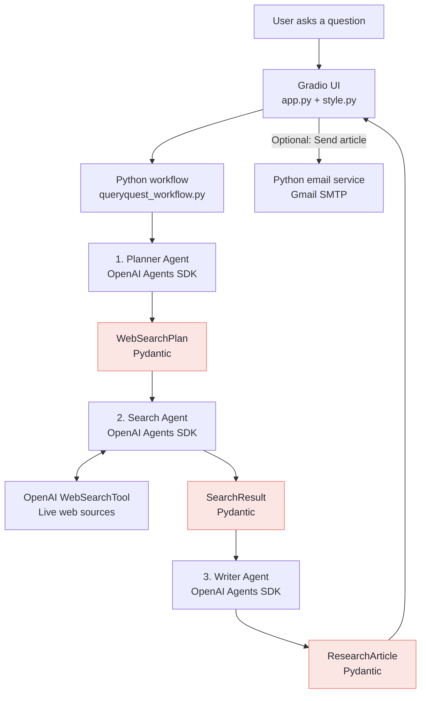

# QueryQuest 🔎

**Ask a question. Research the web. Get a sourced article.**

QueryQuest is a lightweight, multi-agent research application built with the **OpenAI Agents SDK**, **Pydantic**, and **Gradio**. It turns a research question into a plan, searches the web, and writes a structured article with links to its sources. Users can read the article in the browser or send it by email.

**Powered by Dhaval Mistry | Mahantai**

> **Project status:** Working local MVP. Built for learning and experimentation, not yet secured for public use.

## What it does

- **Plans research:** A Planner Agent breaks the question into focused web searches.
- **Finds evidence:** A Search Agent uses OpenAI's `WebSearchTool` and returns findings with source URLs.
- **Writes the article:** A Writer Agent turns the collected evidence into sections, a summary, and citations.
- **Displays results:** A Gradio interface presents the article and clickable sources, with sample questions and **New Chat**.
- **Emails on request:** A Python Gmail SMTP service sends the completed article to an address entered by the user.

## Architecture



**The roles are intentionally separate:** The **OpenAI Agents SDK** runs the agents and their tools. **Pydantic** defines and validates structured outputs (`WebSearchPlan`, `SearchResult`, and `ResearchArticle`). **Python** controls the execution order. **Gradio** handles the interface. No LangChain, LangGraph, database, or separate orchestration framework is required.

### Research flow

1. **Question:** The user enters a topic in Gradio.
2. **Plan:** The Planner generates targeted search queries and explains why each matters.
3. **Search:** The Search Agent researches the selected queries with `WebSearchTool`, collecting findings and original source URLs.
4. **Organize:** Python combines findings, removes duplicate source URLs, and assigns source IDs.
5. **Write:** The Writer receives the question and numbered evidence, then returns a Pydantic `ResearchArticle`.
6. **Deliver:** Gradio renders the article with source links. The user may enter an email address and choose to send it.

The workflow is **sequential and explicit**, making each agent easy to test or improve independently.

## Technology

| Technology | Purpose |
|---|---|
| **Python 3.12 + uv** | Application code and dependency management |
| **OpenAI Agents SDK** (`openai-agents`) | Planner, Search, and Writer agents; execution and tracing |
| **Pydantic** | Typed, validated agent outputs |
| **OpenAI WebSearchTool** | Live web research |
| **Gradio** | Local web interface |
| **Gmail SMTP** | Optional article delivery, using Python's standard email libraries |
| **python-dotenv** | Loads local environment settings |

## Project structure

```text
QueryQuest/
├── app.py                    # Gradio UI and user actions
├── style.py                  # Graphite & Coral theme
├── queryquest_workflow.py    # Planner → Search → Writer
├── QQAgents/
│   ├── planner_agent.py      # Creates WebSearchPlan
│   ├── search_agent.py       # Web searches; returns SearchResult
│   └── writer_agent.py       # Produces ResearchArticle
├── services/
│   └── email_sender.py       # Gmail SMTP and email validation
├── tests/                    # Individual agent and email tests
├── .env                      # Local secrets (never commit)
├── pyproject.toml
├── uv.lock
└── README.md
```

## Run locally

**Requirements:** Python 3.12, [uv](https://docs.astral.sh/uv/), and an [OpenAI API key](https://platform.openai.com/api-keys). Email delivery additionally requires a Gmail account with a Google App Password.

**1. Open the project in PowerShell:**

```powershell
cd C:\code\QueryQuest
uv sync
```

If Gradio or email validation has not yet been added to the project, install them once:

```powershell
uv add gradio email-validator
```

**2. Create or update `.env` in the project root:**

```dotenv
# Required for the three OpenAI agents
OPENAI_API_KEY=your_openai_api_key
DEFAULT_MODEL_NAME=gpt-5.4-mini

# Research settings
HOW_MANY_SEARCHES=5
MAX_SEARCHES_PER_RUN=2

# Optional: Gmail SMTP delivery
EMAIL_ADDRESS=your_gmail_address@gmail.com
EMAIL_APP_PASSWORD=your_google_app_password
EMAIL_SMTP_SERVER=smtp.gmail.com
```

`MAX_SEARCHES_PER_RUN=2` limits how many planned queries the workflow executes while testing. Increase it to `5` for broader research. **This limits planned queries, not necessarily the number of individual billable web-search tool calls.** Use a model available to your OpenAI account for `DEFAULT_MODEL_NAME`.

**3. Start the application:**

```powershell
uv run python app.py
```

Open **http://127.0.0.1:7860**. Keep the terminal open while using the app.

**4. Try this question:**

> What are the most important practices for building reliable AI agents in production? Include security, observability, evaluation, and sources.

Review the article and citation links. To test email, enter a recipient address and select **Send article**.

## Test individual components

```powershell
uv run python -m tests.test_planner
uv run python -m tests.test_search
uv run python -m tests.test_writer
uv run python -m tests.test_email
```

These commands assume the corresponding test modules are present in your project. **The email test sends a real message.** Agent tests and live searches may incur OpenAI API charges.

## Current limitations

- **Local MVP only:** No user login, database, or saved research history. **New Chat** clears the current browser session's article and input.
- **Email needs protection before public deployment:** The current UI validates email syntax but **does not verify that the recipient owns the address**. Add recipient verification, rate limits, and usage safeguards before accepting public traffic.
- **Source quality still matters:** Citations refer to retrieved URLs, but neither Pydantic validation nor an LLM guarantees that every claim is correct. Review important facts against the original sources.
- **Hosting:** The SMTP implementation is intended for local testing. Render Free blocks outbound SMTP ports; public deployment there needs an HTTPS-based email service.
- **Costs:** OpenAI model and web-search usage can incur charges. Keep search limits low while testing.

## Next improvements

- Optional Planner clarification questions before research begins.
- Recipient email verification and basic public-use limits.
- Deployment-ready email delivery and hosting.

## Documentation

[OpenAI Agents SDK](https://openai.github.io/openai-agents-python/) · [Pydantic](https://docs.pydantic.dev/latest/) · [Gradio](https://www.gradio.app/docs) · [uv](https://docs.astral.sh/uv/)

---

*QueryQuest is a hands-on learning project focused on clear architecture, practical AI agents, and verifiable research.*
