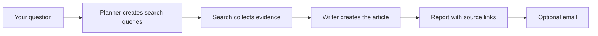

# QueryQuest

**Ask a question. Search the web. Read an article with clickable sources.**

QueryQuest plans research, collects evidence, and writes a report. The page shows which step is running. You can read the report in your browser and optionally email it.

**[Try the AWS public preview](https://d2rof5vhi9w78g.cloudfront.net)** — Claude with AWS web search. The preview allows 3 research attempts per visitor address each day; email is disabled.

## How it works

**[Explore the interactive architecture diagrams](https://dhaval-mistry.github.io/QueryQuest/)** — GPT, AWS, and the live hosting setup. You can also open [docs/index.html](docs/index.html) locally and use **Print / PDF** to share a copy.



## Choose a version

| | OpenAI version | AWS version |
|---|---|---|
| Folder | `QueryQuest_GPT` | `QueryQuest_AWS` |
| AI model | GPT through OpenAI | Claude through Amazon Bedrock |
| Web search | OpenAI WebSearchTool | AWS AgentCore Web Search |
| Python tools | OpenAI Agents SDK | Boto3 |
| Optional email | Gmail SMTP | Amazon SES |
| Setup guide | [OpenAI instructions](QueryQuest_GPT/README.md) | [AWS instructions](QueryQuest_AWS/README.md) |

Both versions have the same interface. Each has its own code, `.env` settings, and dependencies. Changes to one provider do not change the other.

## Run locally

Install **Python 3.12+** and **uv**. Then choose one folder.

**OpenAI / GPT:**

```powershell
cd C:\code\QueryQuest\QueryQuest_GPT
uv sync
# Add OPENAI_API_KEY to this folder's .env.
uv run python app.py
```

**AWS / Claude:**

```powershell
cd C:\code\QueryQuest\QueryQuest_AWS
uv sync
# Configure AWS login and this folder's .env using the AWS setup guide.
uv run python app.py
```

Open **http://127.0.0.1:7860**. Run one app at a time; both use the same port. On a fresh checkout, copy the chosen folder's `.env.example` to `.env` before adding your settings. Keep credentials private.

For AWS project accounts, use `aws login --profile queryquest --region us-east-2` and set `AWS_PROFILE=queryquest`. A Bedrock API token alone does not authorize web search. The default Claude model is `us.anthropic.claude-sonnet-4-6`.

## What to expect

- **Planner -> Search -> Writer:** animated indicators follow the actual steps, including the search query count.
- **Consistent layout:** the page keeps the same width before and after results, and adapts to smaller screens.
- **Sources:** article paragraphs link to retrieved evidence. Check important claims against the original sources.
- **Research limits:** `MAX_SEARCHES_PER_RUN=2` keeps initial runs small. Raise it for broader research.
- **Email:** optional, with separate sender setup. Generating a report does not send it automatically.

## Check the code

From either project folder, run the offline tests:

```powershell
uv run python -m unittest discover -s tests -v
```

These tests do not call model/search services or send emails. The manual model, planner, search, writer, and email checks described in each setup guide do use live services.

## Costs and hosting

Model calls and web searches can incur usage charges. Hosting is a separate cost. [Docker instructions](DOCKER.md) explain how to package either version for AWS or Render. Publishing requires a hosting configuration, unattended credentials, and public usage limits. Your local AWS browser-login session is for development. The [AWS deployment guide](deploy/README.md) describes the server, HTTPS, and public usage limits.

**Powered by Dhaval Mistry | Mahantai**
