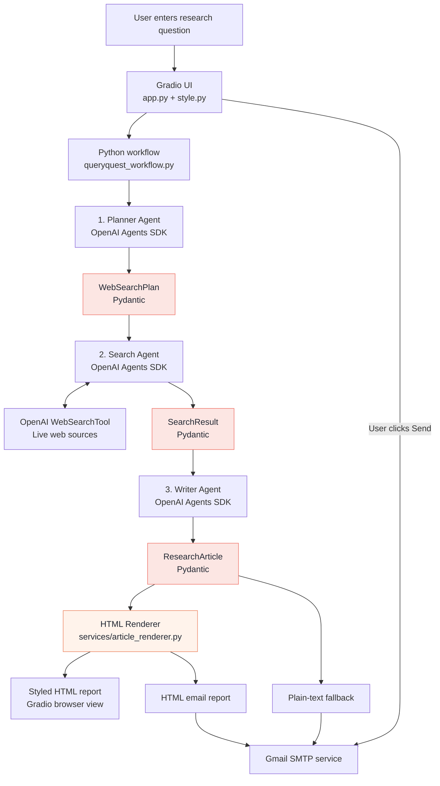

# QueryQuest 🔎

**Ask a question. Research the web. Get a sourced article.**

QueryQuest is a lightweight, multi-agent research application built with the **OpenAI Agents SDK**, **Pydantic**, and **Gradio**. It plans research, searches the web, and produces a structured article with citations. The finished report is presented as a polished HTML article in the browser and can be emailed in a reader-friendly format.

**Powered by Dhaval Mistry | Mahantai**

> **Project status:** Working local MVP for learning and experimentation. Not yet secured for public use.

## What it does

- **Plans research:** A Planner Agent turns a question into focused search queries.
- **Finds evidence:** A Search Agent uses OpenAI's `WebSearchTool` to collect findings and source URLs.
- **Writes an article:** A Writer Agent creates a summary, sections, conclusion, and source citations.
- **Formats the report:** A Python HTML renderer turns the structured article into a professional browser view and an email-friendly layout.
- **Displays results:** Gradio shows the formatted report, sample questions, and a **New Chat** option.
- **Emails on request:** Gmail SMTP sends an HTML report with a plain-text fallback to the address entered by the user.

## Architecture



**Clear responsibilities:** The **OpenAI Agents SDK** runs the agents and web-search tool. **Pydantic** validates the structured outputs (`WebSearchPlan`, `SearchResult`, and `ResearchArticle`). **Python** controls the execution sequence and formats the report. **Gradio** provides the interface. Email is a regular Python service, not another AI agent.

No LangChain, LangGraph, database, or separate orchestration framework is needed.

### Research flow

1. **Ask:** The user enters a research question in Gradio.
2. **Plan:** The Planner generates targeted search queries with reasons.
3. **Search:** The Search Agent uses `WebSearchTool` to collect findings and source URLs.
4. **Organize:** Python combines findings, removes duplicate URLs, and assigns source IDs.
5. **Write:** The Writer returns a validated Pydantic `ResearchArticle` based on the collected evidence.
6. **Format:** `article_renderer.py` creates a styled browser report and a separate email-friendly HTML version. Python also keeps a plain-text fallback.
7. **Deliver:** Gradio displays the report. If the user chooses to send it, Gmail SMTP emails the HTML report.

The workflow is **sequential and explicit**, so each agent can be tested independently. HTML formatting uses ordinary Python and does not require another LLM call.

## Technology

| Technology | Purpose |
|---|---|
| **Python 3.12 + uv** | Application code and dependency management |
| **OpenAI Agents SDK** (`openai-agents`) | Planner, Search, and Writer agents; tool execution and tracing |
| **Pydantic** | Typed, validated agent outputs |
| **OpenAI WebSearchTool** | Live web research |
| **Gradio** | Interactive UI and HTML article display |
| **Python HTML renderer** | Browser and email report layouts, citations, and linked sources |
| **Gmail SMTP** | Optional HTML email with a plain-text fallback |
| **python-dotenv** | Local environment configuration |

## Project structure

```text
QueryQuest/
├── app.py                     # Gradio UI, report display, and email actions
├── style.py                   # Graphite & Coral UI styling
├── queryquest_workflow.py     # Planner → Search → Writer
├── QQAgents/
│   ├── planner_agent.py       # Produces WebSearchPlan
│   ├── search_agent.py        # Web searches; produces SearchResult
│   └── writer_agent.py        # Produces ResearchArticle
├── services/
│   ├── article_renderer.py    # Browser and email HTML formatting
│   └── email_sender.py       # Gmail SMTP and recipient validation
├── tests/
│   ├── test_planner.py
│   ├── test_search.py
│   ├── test_writer.py
│   ├── test_email.py
│   └── test_article_html.py  # Offline HTML and email-format tests
├── .env                       # Local secrets; never commit
├── pyproject.toml
├── uv.lock
└── README.md
```

## Run locally

**Requirements:** Python 3.12, [uv](https://docs.astral.sh/uv/), and an [OpenAI API key](https://platform.openai.com/api-keys). Sending emails also requires a Gmail account and a [Google App Password](https://myaccount.google.com/apppasswords).

**1. Install dependencies:**

```powershell
cd C:\code\QueryQuest
uv sync
```

If Gradio or email validation is not yet listed in the project dependencies, add them once:

```powershell
uv add gradio email-validator
```

**2. Configure `.env` in the project root:**

```dotenv
# OpenAI agents
OPENAI_API_KEY=your_openai_api_key
DEFAULT_MODEL_NAME=gpt-5.4-mini

# Research limits
HOW_MANY_SEARCHES=5
MAX_SEARCHES_PER_RUN=2

# Optional Gmail delivery
EMAIL_ADDRESS=your_gmail_address@gmail.com
EMAIL_APP_PASSWORD=your_google_app_password
EMAIL_SMTP_SERVER=smtp.gmail.com
```

Use a model available to your OpenAI API account. `MAX_SEARCHES_PER_RUN=2` limits the planned queries executed while testing; raise it to `5` for wider coverage. **It does not guarantee only two billable web-search tool calls.** Keep `.env` out of source control.

**3. Launch the app:**

```powershell
uv run python app.py
```

Open **http://127.0.0.1:7860** and keep the terminal running.

**4. Try a research question:**

> What are the most important practices for building reliable AI agents in production? Cover security, observability, evaluation, and supporting sources.

Review the formatted article and source links. To test email delivery, enter an address you control and select **Send formatted report**.

## Testing

Run individual agents and the HTML formatter:

```powershell
uv run python -m tests.test_planner
uv run python -m tests.test_search
uv run python -m tests.test_writer
uv run python -m tests.test_article_html
```

To test SMTP separately:

```powershell
uv run python -m tests.test_email
```

The HTML test runs without calling OpenAI or sending email. **The SMTP test sends a real message.** Agent and web-search tests may incur API charges.

## Current limitations

- **Local MVP:** No sign-in, database, or saved research history. **New Chat** clears the current session's inputs and report.
- **Email safety:** Recipient addresses are checked for valid syntax, but **ownership is not verified**. Add recipient verification and rate limits before making the app public.
- **Research accuracy:** Citations point to retrieved sources, but structured validation does not prove every claim. Verify important findings against the original material.
- **Hosting:** Gmail SMTP works for local testing; Render Free blocks outbound SMTP ports. Public deployment there requires an HTTPS-based email service.
- **Usage costs:** OpenAI model and web-search calls may incur charges. Use small search limits during development.

## Next improvements

- Let the Planner ask clarification questions before searching.
- Add recipient email verification and basic usage protection.
- Prepare production hosting and HTTPS email delivery.

## Documentation

[OpenAI Agents SDK](https://openai.github.io/openai-agents-python/) · [Pydantic](https://docs.pydantic.dev/latest/) · [Gradio](https://www.gradio.app/docs) · [uv](https://docs.astral.sh/uv/)

---

*QueryQuest is a hands-on learning project focused on simple architecture, practical AI agents, and research backed by sources.*
